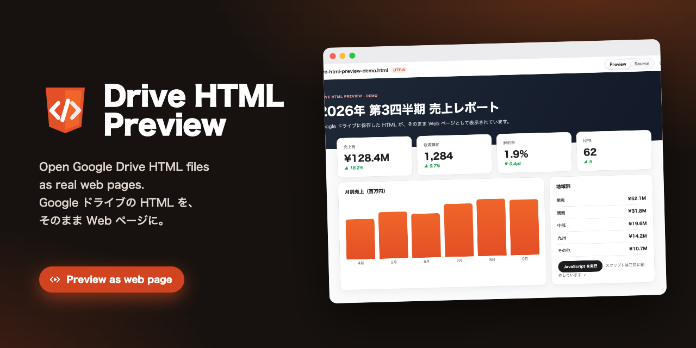
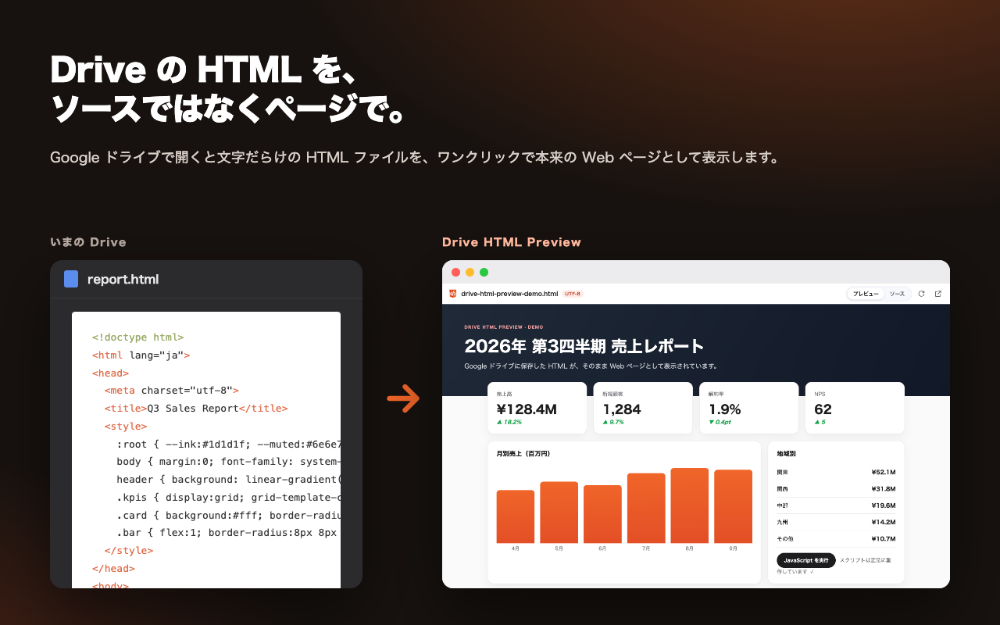
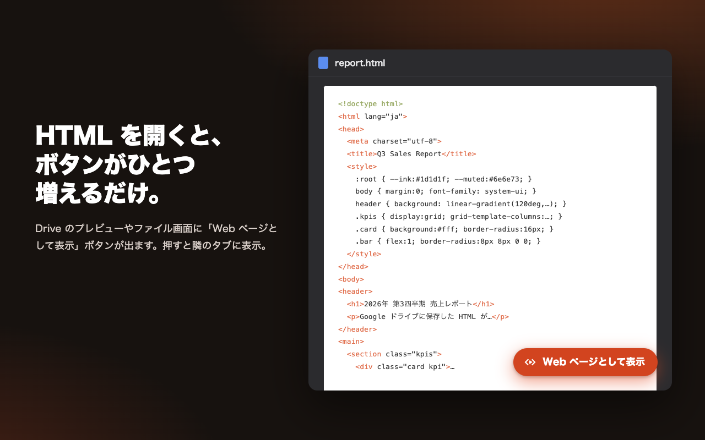
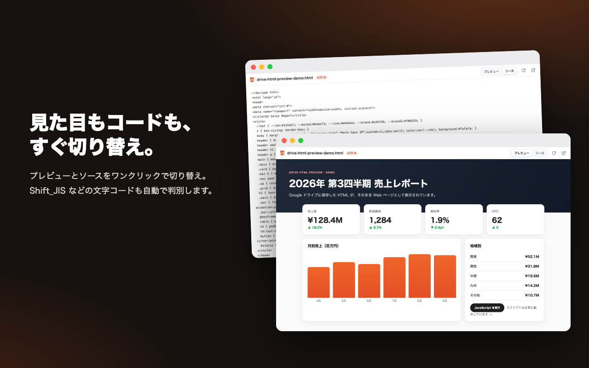
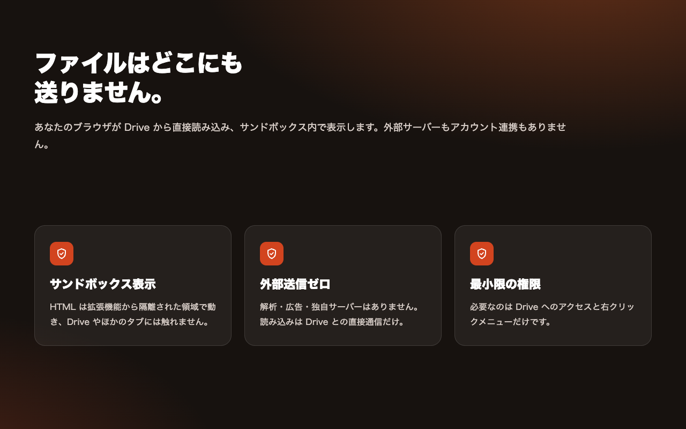

<div align="center">


# Drive HTML Preview

**Google ドライブの HTML ファイルを、ソースではなく本来の Web ページとして開く Chrome 拡張機能。**<br>
Drive にボタンがひとつ増えるだけ。押せば隣のタブにページが表示されます。スクリプトも動き、文字コードも自動判別。データはどこにも送りません。

[](https://chromewebstore.google.com/search/Drive%20HTML%20Preview)
[](https://github.com/JapanMarketing-Dev/chrome-ext-drive-html-preview/releases)
[](LICENSE)
[](src/manifest.json)
[](PRIVACY.md)

[インストール](#インストール) · [しくみ](#しくみ) · [プライバシー](PRIVACY.md) · [開発](#開発)

[English](README.md) · **日本語**

<br>



</div>

<br>

## Drive は HTML を文字で見せる。これはページで見せる。

Google ドライブで `.html` を開くと、表示されるのはタグの羅列です。ツールから書き出したレポート、試作画面、メールマガジン、AI が作ったページ……どれもダウンロードしてローカルで開くまで読めません。

Drive HTML Preview を入れると、Drive で HTML ファイルを開いたときに **「Web ページとして表示」** ボタンが出ます。押すと、隣のタブにきちんと描画されたページが開きます。



## 開いたその場に、ボタンがひとつ

ボタンは Drive のプレビュー（フォルダでファイルをダブルクリックしたとき）と、ファイルページ（`drive.google.com/file/d/…`）に表示されます。ほかにも：

- Drive で HTML を開いた状態で、拡張機能の **ツールバーアイコン** を押す
- Gmail や Slack などにある **Drive のファイルリンクを右クリック** して「Drive の HTML を Web ページとしてプレビュー」を選ぶ
- どこでもツールバーアイコンを押して、**Drive のリンクを貼り付ける**



## ページとコードをワンクリックで切り替え

表示中のページとソースをすぐ切り替えられます。文字コードはブラウザと同じ順序（BOM → `Content-Type` → `<meta charset>`）で判定し、Shift_JIS・EUC-JP などの古い文字コードも自動で扱います。



## ファイルはどこにも送りません



| | |
|---|---|
| **サンドボックス表示**　HTML は拡張機能から隔離された、オリジンを持たないサンドボックスで動きます。拡張機能・Drive のログイン状態・ほかのタブには触れられません。 | **サーバーなし**　ファイルはあなたのブラウザが、あなたのログイン状態で Drive から直接読み込みます。解析・広告・アカウント連携はありません。 |
| **最小限の権限**　必要なのは `drive.google.com` / `drive.usercontent.google.com` へのアクセスと、右クリックメニューひとつだけ。 | **開けるものはそのまま開ける**　共有ドライブ、共有されたファイル、複数アカウントのログイン（`/u/1/`）、リソースキー付きのリンクにも対応。 |

## インストール

**Chrome ウェブストア：** [Drive HTML Preview](https://chromewebstore.google.com/search/Drive%20HTML%20Preview) を開き「Chrome に追加」を押します。

**ソースから：**

1. [Releases](https://github.com/JapanMarketing-Dev/chrome-ext-drive-html-preview/releases) から `drive-html-preview-<version>.zip` をダウンロードして展開します（またはこのリポジトリを clone）。
2. `chrome://extensions` を開き、**デベロッパー モード** をオンにします。
3. **パッケージ化されていない拡張機能を読み込む** を押し、展開したフォルダ（clone した場合は `src/`）を選びます。

## しくみ

```
Drive の画面 ──(ファイル ID と名前)──▶ content script ──▶ service worker ──▶ ビューアのタブ
                                                                              │
                      drive.google.com/uc?export=download&id=…  ◀─────────────┘  あなたのログインで取得
                                                                              │
                                        サンドボックス iframe ◀── 文字コード変換後の HTML ┘
```

- `src/content.js` が画面上の HTML ファイルを特定します。ファイルページでは URL から、プレビューでは表示中のファイル名と開いた一覧の項目を照合します。
- `src/viewer.js` がファイルをダウンロードし、文字コードを判定して（`src/lib/html.js`）、オリジンを持たないサンドボックスページ `src/sandbox.html` に渡します。
- 外部サイトへのリンクは新しいタブで開きます。Drive の別ファイルを指す相対リンクや画像は、Drive のファイルごとに ID が違うため解決できません。

### 制限

- Drive 上の別ファイルへの相対パス（`./style.css`、`images/a.png` など）は読み込めません。インライン化するか、絶対 URL を使ってください。
- 50 MB を超えるファイルは表示しません。
- オーナーが閲覧者のダウンロードを禁止している場合、拡張機能もファイルを取得できません。

## 開発

```bash
npm install
npm test                 # 単体テスト（node:test + jsdom）
npm run test:integration # Chromium に拡張機能を読み込んで全体の流れを確認
npm run build            # dist/drive-html-preview-<version>.zip を作成
npm run assets           # アイコンとストア画像を再生成
```

`npm run assets` で使うスクリーンショットを更新するときは、結合テストを `SHOTS_DIR=docs/images/shots/ja UI_LANG=ja` 付きで実行します。

## ライセンス

[MIT](LICENSE) © 2026 JapanMarketing-Dev
