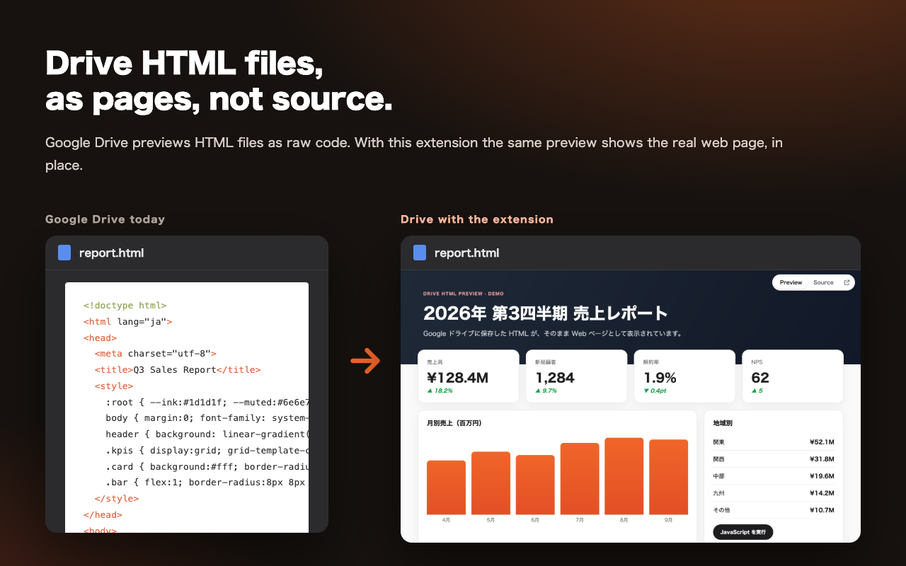
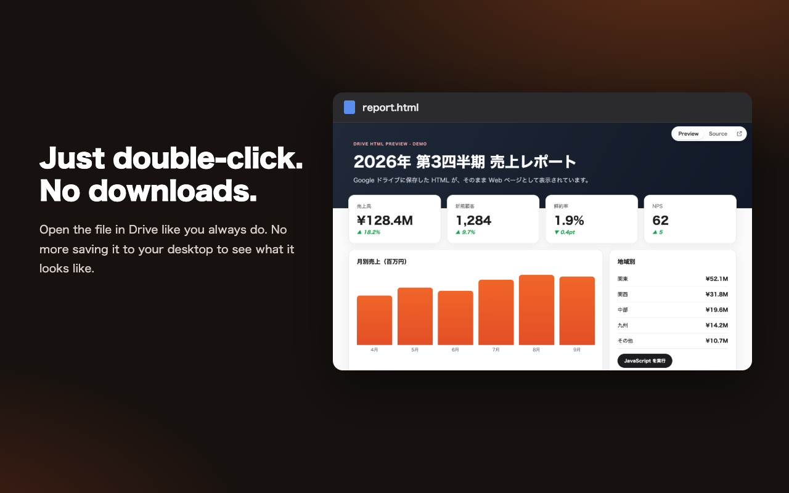
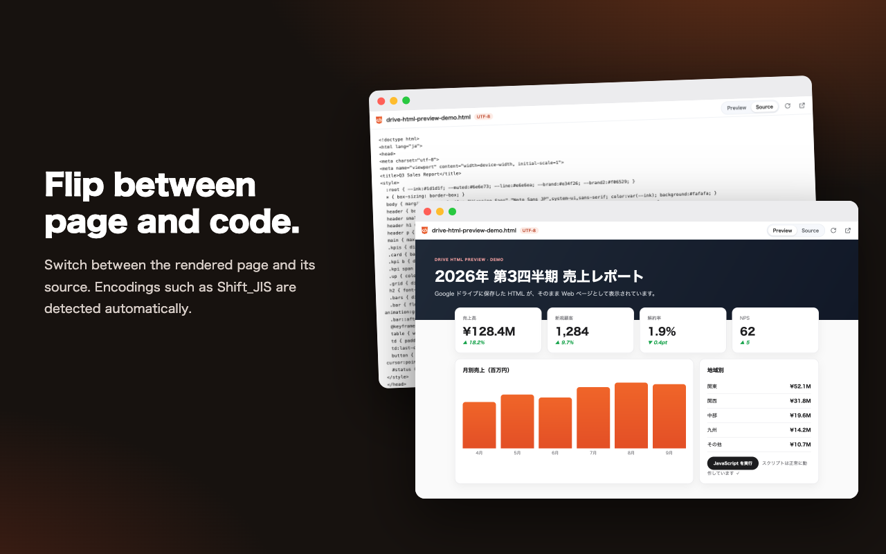
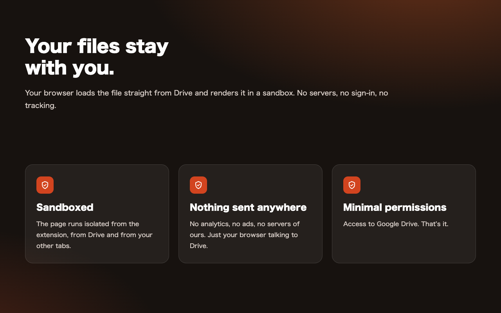

<div align="center">


# Drive HTML Preview

**See HTML files in Google Drive's own preview as real web pages, not raw source.**<br>
Double-click an `.html` file in Drive and the rendered page appears right there. Scripts run, encodings are detected, nothing leaves your browser.

[](https://chromewebstore.google.com/search/Drive%20HTML%20Preview)
[](https://github.com/JapanMarketing-Dev/chrome-ext-drive-html-preview/releases)
[](LICENSE)
[](src/manifest.json)
[](PRIVACY.md)

[Install](#install) · [How it works](#how-it-works) · [Privacy](PRIVACY.md) · [Development](#development)

**English** · [日本語](README.ja.md)

<br>


</div>

<br>

## Drive shows your HTML as text. This shows it as a page.

Preview an `.html` file in Google Drive and you get a wall of tags. Reports exported from tools, prototypes, newsletters, AI-generated pages: until now you had to download each one and open it on your desktop to see it. (Slack previews HTML; Drive doesn't.)

With Drive HTML Preview installed, Drive's preview simply shows the page. Nothing to click.



## Just double-click. No downloads.

It works wherever Drive previews a file: the overlay you get by double-clicking a file in a folder, search results, shared drives, and file pages (`drive.google.com/file/d/…`). Use Drive's own arrows to move to the next file and the preview follows.

A small switch at the top right flips between the page and its source, or opens the page in a full tab. The toolbar icon also opens the current file in a full tab, or lets you paste any Drive link.



## Page or code, one click apart

Switch between the rendered page and its source. Character encodings are picked like a browser would (BOM, `Content-Type`, `<meta charset>`), with Shift_JIS / EUC-JP and other legacy encodings handled automatically.



## Your files stay with you



| | |
|---|---|
| **Sandboxed.** The HTML runs in an isolated, opaque-origin sandbox. It can't touch the extension, your Drive session or your other tabs. | **No servers.** Your browser downloads the file straight from Drive with your own sign-in. No analytics, no ads, no account linking. |
| **Minimal permissions.** Access to `drive.google.com` / `drive.usercontent.google.com`. Nothing else. | **Works with what you can already open.** Shared drives, shared files, multiple signed-in accounts (`/u/1/`), resource-key links. |

## Install

**Chrome Web Store:** search for [Drive HTML Preview](https://chromewebstore.google.com/search/Drive%20HTML%20Preview) and click *Add to Chrome*.

**From source:**

1. Download `drive-html-preview-<version>.zip` from [Releases](https://github.com/JapanMarketing-Dev/chrome-ext-drive-html-preview/releases) and unzip it (or clone this repository).
2. Open `chrome://extensions`, turn on **Developer mode**.
3. Click **Load unpacked** and pick the unzipped folder (or `src/` in the clone).

## How it works

```
Drive preview ──(file ID + name)──▶ content script ──▶ frame over Drive's text page
                                                          │  viewer.html?embed=1
          drive.google.com/uc?export=download&id=…  ◀─────┤  fetch with your session
          (falls back to the text Drive already shows)    │
                              sandboxed iframe ◀── decoded HTML
```

- `src/content.js` finds the HTML file on screen (from the URL on file pages, or by matching the overlay's file name to the list item you opened), finds Drive's text pages and lays a frame over them.
- `src/viewer.js` downloads the file, detects its encoding (`src/lib/html.js`) and hands the text to `src/sandbox.html`, a manifest sandbox page with an opaque origin. If the download is refused, it uses the text Drive is already showing.
- Links to other sites open in a new tab. Relative links and images that point at sibling files in Drive can't be resolved, because each Drive file has its own ID.

### Limitations

- Relative paths (`./style.css`, `images/a.png`) to other Drive files don't load. Inline them, or use absolute URLs.
- Files over 50 MB aren't previewed.
- If the owner turned off downloading for viewers, the extension renders the text Drive shows instead, which Drive may cut short for very long files.

## Development

```bash
npm install
npm test                 # unit tests (node:test + jsdom)
npm run test:integration # loads the extension in Chromium and checks the whole flow
npm run build            # dist/drive-html-preview-<version>.zip
npm run assets           # re-render icons and store images
```

Set `SHOTS_DIR=docs/images/shots/en UI_LANG=en` for the integration run to refresh the screenshots used by `npm run assets`.

## License

[MIT](LICENSE) © 2026 JapanMarketing-Dev
